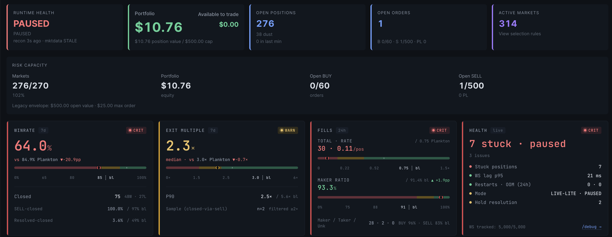
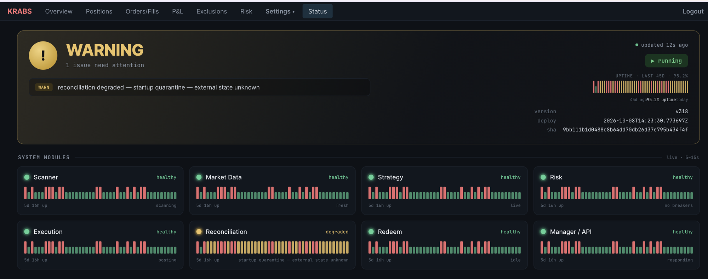
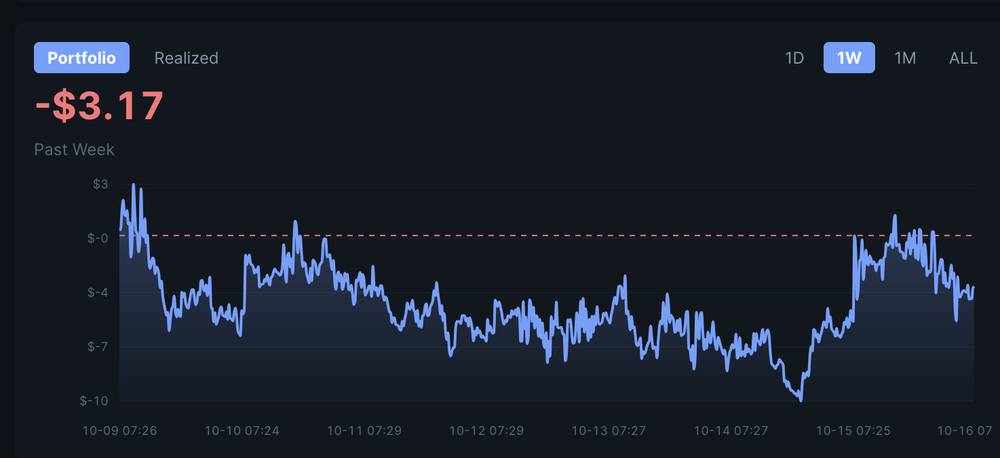
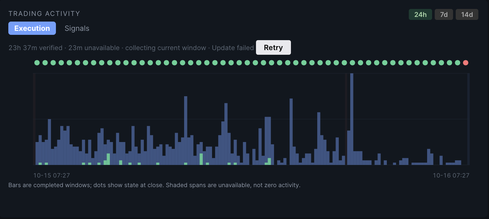

# Krabs — a Polymarket copy-trading experiment

> **Status: archived (October 2026).** The bot was stopped and its live account was liquidated on
> 2026-10-16. It traded with real money and finished **around break-even, with no meaningful
> profit**. The code is published as a reference, not as a working
> money-maker. Running it risks real funds; nothing here is financial advice.

## What this was

Krabs is a TypeScript trading bot for [Polymarket](https://polymarket.com) prediction markets. Its
goal was to **replicate the strategy of a consistently profitable Polymarket trader,
[planktonXD](https://polymarket.com/@planktonXD)**
([wallet](https://polymarket.com/profile/0x4ffe49ba2a4cae123536a8af4fda48faeb609f71)), as faithfully
as possible, and only then improve on it. His account shows about +$146k of lifetime profit on
roughly $5.7M of volume.

The strategy, reconstructed from that trader's on-chain history:

- **Entry.** Buy very cheap outcome tokens (mostly below 5¢, many below 1¢) on long-dated markets,
  in small scale-in fills of about a dollar each, across hundreds of markets at once.
- **Exit.** Rest a sell order for a "bounce" — a target about +25.7% above entry, which is the
  median realized round-trip return in the trader's history (n = 17,688 round trips).
- **No stop-loss.** Positions that never bounce are held to resolution. Most of them expire
  worthless.

Every parameter was derived from the trader's realized data rather than chosen by hand. Each
hypothesis was tested before it shipped (see [What was analyzed](#what-was-analyzed)).

## Result

The final version of the strategy (a single-rung bounce exit) went live on 2026-10-05 and ran
until the account was liquidated on 2026-10-16:

| Since 2026-10-05 (11 days)   | Value                                       |
| ---------------------------- | ------------------------------------------- |
| Fills                        | 621 (401 buys for $145, 220 sells for $141) |
| New positions opened         | 178                                         |
| Bounced and sold with profit | 85 (+$24 realized)                          |
| Expired worthless            | 19 (−$12)                                   |
| Account result               | about +$6 (≈ +2% of volume)                 |

The result is **around zero**. It cannot be pinned down more precisely: 68 of the 178 new
positions were still open, and valuing them at the mid or at the bid swings the cohort from −$10 to
+$7.

Why it could not do better:

1. **The edge itself is thin.** The copied trader's own trading profit fell from 3–9% of volume in
   2025 to about 0.5–2.7% in 2026, with negative months. In mid-2026 most of his profit came from
   Polymarket **liquidity rewards and maker rebates**, which need very large resting size
   (about $250k of volume per month). That is not reachable at a small scale.
2. **Burns cancel bounces.** In the trader's own history, legs that bounce earn about +33%, legs
   that expire worthless lose about −31%, and they roughly offset (−1.9% net in Feb–Mar 2026).
3. **No entry filter separates burners from bouncers.** Price bands, category, liquidity, market
   age and timing were all tested. None predicts at entry time which positions will burn.
4. **Bigger bets only scale the zero.** Capital was never the binding constraint. A larger size
   multiplies a per-dollar edge of about 0%.

## Screenshots

The operator dashboard (React, served by the API). These were taken during the final week and on
the day the account was liquidated.

**Overview.** Runtime health, positions, orders and risk capacity. Below that, the bot's own metrics
are compared live with the copied trader's baseline (`bl`): win rate, exit multiple, fill rate and
maker ratio.



**Status.** Health history of every runtime module, uptime and the deployed version.



**P&L.** Account P&L for the final week, hovering around zero.



**Trading activity.** Executed orders per 10-minute window over the last 24 hours.



## Architecture

A pnpm + Turborepo monorepo, Node ≥ 24.

```
packages/domain     branded IDs, types, event-bus contract, repository/gateway interfaces
packages/event-bus  in-process async pub/sub
packages/config     Zod-validated environment loader
packages/db         SQLite (better-sqlite3) repositories and migrations
packages/exchange   Polymarket CLOB / Gamma / data-api gateways (+ simulation doubles)
apps/runtime        the bot: supervisor, modules, event wiring
apps/api            Fastify REST API + SSE for the operator dashboard
apps/web            React 18 + Vite + TanStack Query dashboard
```

Runtime modules talk only over the event bus:

```
MarketScanner → MarketData → Normalization → Strategy → RiskInventory → Execution
                                                            ↓
                                            Reconciliation ← (polls exchange)
                                            Resolution     ← (detects resolved markets)
```

More detail is in `docs/architecture_guidelines.md` and `docs/team_output/`.

## Setup

```bash
pnpm install
pnpm run build
pnpm run test
```

Only the `live-lite` profile can be run; `simulation` and `paper` remain as test doubles. **The
runtime always starts paused** and places no orders until it is resumed from the dashboard or the
API.

```bash
cp .env.example .env            # fill in the keys below
pnpm --filter @krabs/runtime start
pnpm --filter @krabs/api start  # API + dashboard on http://localhost:3100
```

### Deploying to a server

`deploy.sh` builds the Docker image locally, pushes it to a container registry and starts it on a
server over SSH. Copy `.env.deploy.example` to `.env.deploy` and set:

- `KRABS_SERVER_HOST`, `KRABS_SERVER_USER`, `KRABS_SERVER_PATH` — your server and install path;
- `KRABS_IMAGE_REPO` — your image repository (also update `image:` in `docker-compose.yml`).

`deploy/nginx-krabs.conf` is a reverse-proxy template for the dashboard: replace `bot.example.com`
with your domain. Runbooks under `docs/runbooks/` use `your.server.ip` and `bot.example.com` as
placeholders in the same way.

### Keys you need

No keys are committed. Put them in a local, git-ignored `.env` (templates: `.env.example`,
`.env.production.example`).

| Variable                                                                 | What it is                                                                                                              |
| ------------------------------------------------------------------------ | ----------------------------------------------------------------------------------------------------------------------- |
| `POLY_PRIVATE_KEY`                                                       | Private key of the signing wallet (`0x` + 64 hex). Controls real funds.                                                 |
| `POLY_API_KEY`, `POLY_API_SECRET`, `POLY_PASSPHRASE`                     | Polymarket CLOB API credentials, derived from the signing wallet (`createOrDeriveApiKey` in `@polymarket/clob-client`). |
| `POLY_BUILDER_CODE`                                                      | bytes32 builder code from your Polymarket Builder Profile; required for live orders.                                    |
| `POLY_BUILDER_API_KEY`, `POLY_BUILDER_SECRET`, `POLY_BUILDER_PASSPHRASE` | Builder credentials for the relayer (proxy-wallet settlement and redeem).                                               |
| `ALCHEMY_POLYGON_KEYS`                                                   | Comma-separated Alchemy keys for Polygon RPC reads and settlement.                                                      |
| `POLYGON_RPC_FALLBACK_URL`                                               | Optional last-resort public RPC URL.                                                                                    |
| `KRABS_API_KEY`                                                          | Your own long random bearer token for the operator API. Not a Polymarket key.                                           |
| `KRABS_AUTH_USERNAME`, `KRABS_AUTH_PASSWORD`, `KRABS_SESSION_SECRET`     | Optional dashboard login.                                                                                               |
| `LIVE_LITE_CONFIRM=true`                                                 | Explicit opt-in for real orders.                                                                                        |

The wallet mode (EOA or Polymarket proxy wallet via the relayer), envelope caps, selection rules and
size rules live in `control.db`. They are edited through the dashboard, not through files. Read
`docs/runbooks/first_launch_guide.md` and `docs/runbooks/live_lite_preflight.md` before a first
run.

## What was analyzed

The research data and scripts are not part of this repository. The analysis was built from three
sources:

- the copied trader's full fill history and round trips (Polymarket data-api);
- Polymarket CLOB price history and a live WebSocket order-book capture of the markets he traded;
- the bot's own production ledger.

About 40 hypotheses were tested, each with a recorded verdict:

- **Entry selection.** Filters by price band, market category, liquidity, market age, discovery
  timing, order-book health at entry, and an "avoid what the trader avoids" model. None separated
  losing entries from winning ones at entry time.
- **Exit.** Bounce-target ladders versus a single target, asking at the best ask versus resting at
  the target, time-based cuts, loss floors and give-up rules. The single-rung
  bounce at the trader's median return was kept; every cut or stop lost money against holding.
- **Sizing.** Bigger bets and scale-in policies. Size does not create an edge, it only multiplies
  the existing one.
- **Other income.** Polymarket liquidity rewards and maker rebates. They need a minimum resting
  size of about $20 per order and two-sided quoting near the mid, which is not reachable at this
  scale.
- **The trader's real economics.** In 2025 he earned 3–9% of volume per month. In 2026 that fell to
  0.5–2.7%, with losing months, and rewards plus rebates became most of his profit.

`docs/validated_strategy_rulebook.md` describes the strategy rules as implemented.
